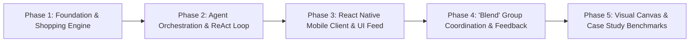

# AI Personal Outfit Styling & Shopping Agent ("Blend")
## Phased Implementation Architecture & Roadmap

This document outlines the phased engineering roadmap for the **AI Personal Outfit Styling & Shopping Agent**, detailing the system milestones, deliverables, technical architecture, and verification benchmarks for academic evaluation.

---

---

## Phase 1: Foundation & Live Shopping Engine

### Objective
Establish the foundational backend architecture and build a provider-independent product discovery layer that integrates real-time Indian fashion retail data.

### Key Deliverables
* **FastAPI Backend Core**: REST API gateway with asynchronous request handling, CORS middleware for mobile connectivity, and health diagnostics.
* **Provider-Independent Abstraction (`IProductSearchProvider`)**: A decoupled contract allowing transparent switching between live shopping scrapers/APIs, affiliate feeds, and deterministic offline fixtures.
* **Live Shopping Provider (`SerpApiShoppingProvider`)**:
  * Real-time queries targeting Google Shopping India (`gl=in`, `hl=en`, `currency=INR`).
  * Aggregation across major Indian retailers: **Myntra, Flipkart, Amazon India, Ajio, Tata CLiQ, and Zara India**.
  * Structured JSON parsing for titles, INR prices (`extracted_price`), merchant source, image thumbnails, customer ratings, and delivery estimates.
* **Controlled Fixture Provider (`ControlledFixtureProvider`)**:
  * Curated 14-item catalog of real Indian retail apparel tagged with gender, category, colors, and pricing.
  * Guarantees 100% reproducible execution of edge cases (budget overruns, stockouts) during demonstrations.
* **Data Schemas**: Strongly-typed Pydantic v2 models for products, user requests, constraints, and trace steps.

### Milestone Status
* **Status**: **Completed**
* **Verification**: Unit and integration tests passing (`test_shopping_provider_contract`).

---

## Phase 2: Autonomous Agent Orchestrator & Bounded ReAct Loop

### Objective
Implement genuine, observable agentic behavior with a bounded execution loop, dynamic tool invocation, deterministic constraint validation, and autonomous self-correction (replanning).

### Key Deliverables
* **Bounded Execution State Machine**:
  * Hard limits of 6 iterations and a 45-second execution timeout to prevent runaway loops or budget leaks.
  * Formal phases: `UNDERSTAND_GOAL` $\to$ `DECOMPOSE_PLAN` $\to$ `SELECT_TOOL` $\to$ `EXECUTE_TOOL` $\to$ `EVALUATE_CONSTRAINTS` $\to$ `REPLAN` $\to$ `SYNTHESIZE_EXPLANATION` $\to$ `COMPLETED`.
* **Deterministic Constraint Engine (`ConstraintEngine`)**:
  * Strict arithmetic evaluation of total ensemble cost against user budget headroom.
  * Size inventory verification across categories (`top`, `bottom`, `shoes`).
  * Delivery deadline feasibility checks.
* **Autonomous Replanning Engine**:
  * Automatically catches `ConstraintStatus.VIOLATED` when an ensemble breaches constraints.
  * Identifies the highest-ticket offending item, calculates remaining budget headroom, prunes redundant layers, and queries targeted replacements.
  * Emits `ConstraintStatus.REPAIRED` and logs decision trade-offs into the telemetry trace.
* **Google Gemini 2.5 Flash SDK Integration**:
  * Structured function calling and reasoning hooks via official `google-genai` SDK.
  * Ready for dynamic prompt routing when `GEMINI_API_KEY` is supplied in `.env`.

### Milestone Status
* **Status**: **Completed (Heuristic Engine) / Ready for Key (LLM Inference)**
* **Verification**: Scenario 1 and Scenario 2 automated tests passing (`test_scenario_1_standard_outfit_assembly`, `test_scenario_2_budget_overrun_detection_and_replanning`).

---

## Phase 3: Mobile Client & Real-Time Agent Activity Feed

### Objective
Deliver a contemporary, luxury fashion-tech mobile application for physical smartphones (via Expo Go) and web browsers.

### Key Deliverables
* **Cross-Platform Mobile Application**:
  * Built with **React Native**, **Expo SDK 58**, and **TypeScript**.
  * Zero-compile web support for browser-based classroom presentations (`npx expo start --web`).
* **Stylist Studio Screen**:
  * User inputs for occasion, aesthetic theme, gender, sizing (top, bottom, shoes), and budget in ₹ INR.
  * One-click demo buttons for immediate case-study presentation (Scenario 1, Scenario 2, and Festive Chic).
* **Agent Activity Inspector Screen (Core Evaluation Differentiator)**:
  * Exposes the agent's internal reasoning, step number, phase chip, tool parameters, observations, and constraint alerts (`⚠️ CONSTRAINT VIOLATED` $\to$ `✓ AUTONOMOUSLY REPAIRED`).
* **Outfit Showcase Screen**:
  * Complete look summary with total savings and compatibility scores.
  * Interactive product cards featuring merchant badges, verified source badges, sizes, delivery notes, and direct "Buy on Retailer" deep links.

### Milestone Status
* **Status**: **Completed**
* **Verification**: Clean TypeScript compilation (`tsc --noEmit`), clean Metro production bundle export (`dist`), and verified live UI.

---

## Phase 4: Collaborative "Blend" Feature & Feedback Loop

### Objective
Enable multi-user collaborative group styling where friends synchronize their aesthetic for events without forcing uniform budgets or styles.

### Key Deliverables
* **Blend Room Architecture (`BlendCoordinator`)**:
  * Shared event rooms initialized with an occasion, shared theme (e.g., "Royal Retro"), and shared color palette (e.g., Navy Blue, Champagne Gold, Ivory).
* **Multi-Profile Coordination Engine**:
  * Allows multiple friends to join with their individual style, silhouette, and budget (e.g., Arjun with ₹6,000 Formal vs. Sneha with ₹3,500 Indo-Western Kurti).
  * Agent distributes complementary color roles across members to prevent color clashes.
* **Group Cohesion Metric**:
  * Calculates an overall group harmony score (0–100%) and generates a stylist harmonization rationale.
* **User Critique & Targeted Replanning**:
  * Single-item "Swap" action and feedback input (`"Swap loafers for white casual court sneakers"`).
  * Re-triggers the agent to adapt the outfit while maintaining color harmony and budget boundaries.

### Milestone Status
* **Status**: **Completed**
* **Verification**: Blend room creation, member joining, and group coordination verified via `test_scenario_5_blend_group_coordination`.

---

## Phase 5: Visual Canvas, Case Study Benchmarks & Final Polish

### Objective
Complete the evaluation package with automated benchmark demonstrations, visual canvas rendering, and final academic documentation.

### Key Deliverables
* **Outfit Moodboard / Visual Canvas**:
  * 2D aesthetic flat-lay canvas generator composing verified merchant product images onto a coordinated background.
* **Complete 7-Scenario Case Study Suite**:
  1. *Scenario 1*: Themed Look Under Budget (Verified).
  2. *Scenario 2*: Budget Overrun & Autonomous Self-Correction (Verified).
  3. *Scenario 3*: Out-of-Stock Size Handling & Alternative Substitution.
  4. *Scenario 4*: Negative User Feedback Adaptation (Verified).
  5. *Scenario 5*: Multi-User "Blend" Group Coordination (Verified).
  6. *Scenario 6*: Mathematical Constraint Satisfaction Explanation.
  7. *Scenario 7*: Failsafe Controlled Fixture Demonstration Mode.
* **Documentation & Presentation Packaging**:
  * Final slide decks, architecture diagrams, and one-click execution scripts.

### Milestone Status
* **Status**: **In Progress / Next Up**

---

## Roadmap Summary Table

| Phase | Milestone Name | Focus Area | Status |
| :---: | :--- | :--- | :---: |
| **1** | **Foundation & Shopping Engine** | FastAPI, SerpApi Google Shopping India, Pydantic Schemas, Fixtures | **Completed** |
| **2** | **Agent Orchestrator & Bounded Loop** | ReAct cycle, ConstraintEngine, Budget Replanning, Gemini API hooks | **Completed (Heuristics) / Key Ready (LLM)** |
| **3** | **React Native Mobile Client** | Expo SDK 58, TypeScript, Stylist Studio, Agent Activity Inspector | **Completed** |
| **4** | **"Blend" Group Styling & Feedback** | Multi-user coordination rooms, Shared palette sync, Item swap loop | **Completed** |
| **5** | **Visual Canvas & Case Study Scenarios** | Editorial Moodboard generator, Complete 7-scenario evaluation suite | **In Progress** |
